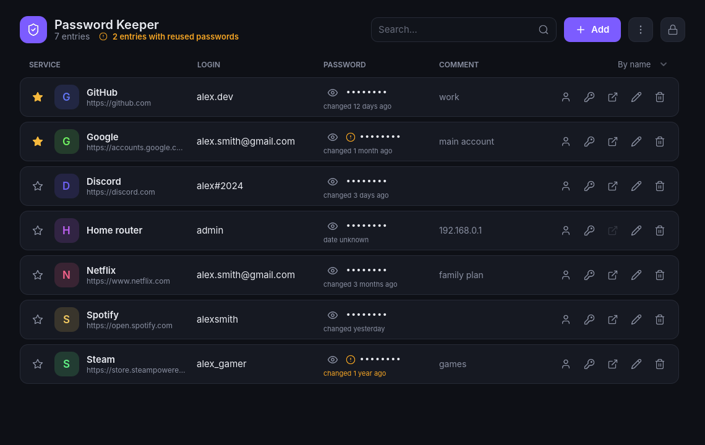
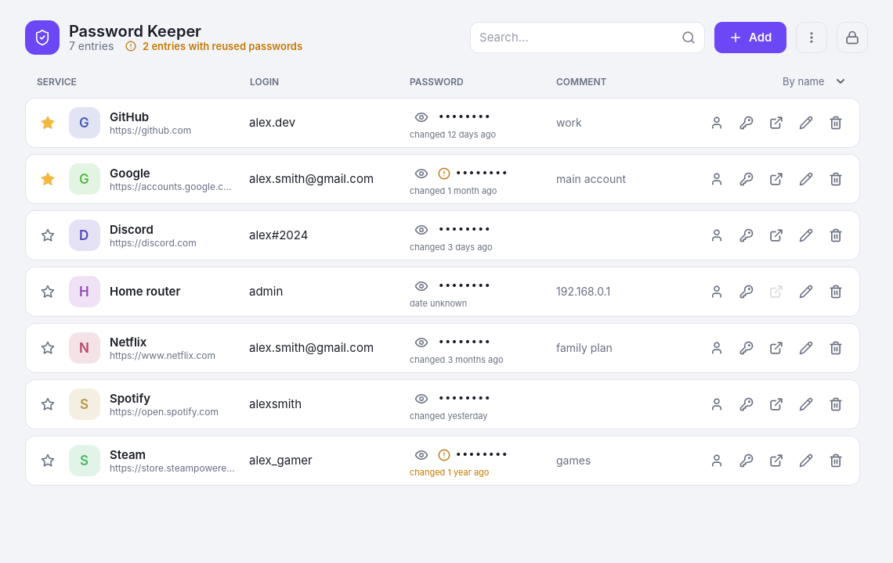
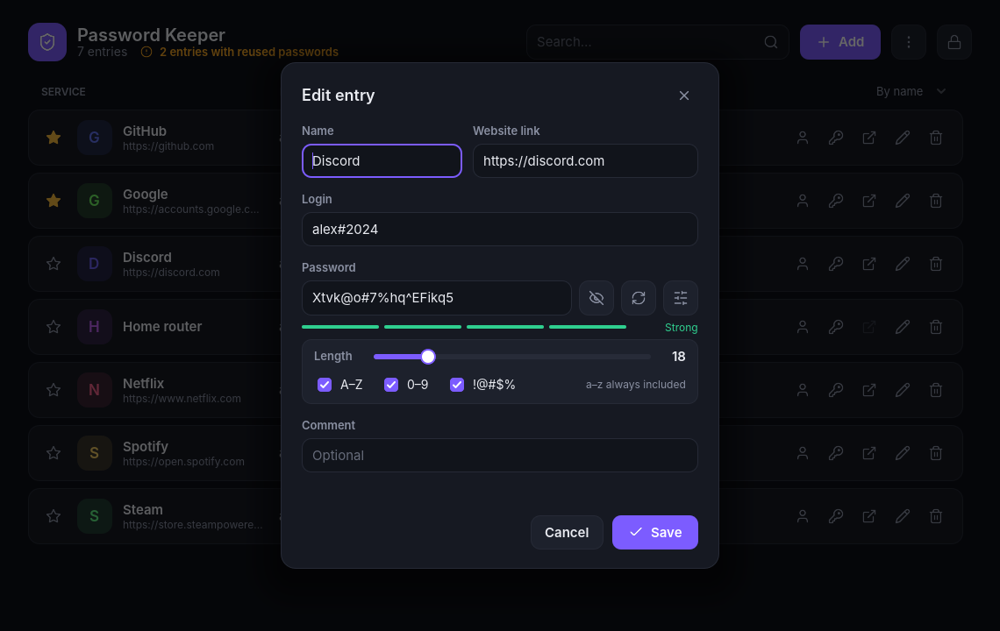

# Password Keeper

**English** · [Русский](README.ru.md)

A simple, local password manager for Windows, made with [Godot 4](https://godotengine.org) and GDScript.
Your passwords never leave your computer: they are stored in one encrypted file.

## Features

- **Strong encryption** — AES-256 with a key derived from your master password via PBKDF2-HMAC-SHA256 (300 000 rounds) and a random salt. Every file is signed with HMAC, so a wrong password or a damaged file is detected.
- **Safe saving** — data is written to a temporary file first and verified; the previous version is kept as a backup. If the power goes out mid-save, nothing is lost.
- **Auto-lock** after 5 minutes of inactivity; revealed passwords hide again after 15 seconds; copied passwords are wiped from the clipboard after 30 seconds.
- **Password generator** — choose length (8–64) and character sets; strength meter.
- **Reused password detection** — see which entries share the same password.
- **Favorites, sorting, search** — by name, by password age, by date added.
- **Password age** — "changed 3 months ago"; passwords older than a year are highlighted.
- **Backups** — save an encrypted copy anywhere (e.g. to a cloud folder) and restore entries from it.
- **Import from browsers** — CSV from Chrome, Edge, Yandex Browser, Firefox, Bitwarden and KeePass.
- **Website logos** — optional, downloaded once and stored encrypted.
- **Light and dark themes**, follows the Windows setting.
- **English and Russian** interface.
- **HiDPI support** — scales with Windows display scaling; Ctrl + / Ctrl − / Ctrl 0 to zoom.
- **Single instance** — launching the app a second time brings the open window to the front.

| Light theme | Editing an entry |
|---|---|
|  |  |

## Download

Get the latest `PasswordKeeper.exe` from the [Releases](../../releases) page. No installation needed — just run it.

> Windows may show "Windows protected your PC" because the program is not code-signed. Click **More info → Run anyway**.

## Where is my data?

Everything is stored in `%APPDATA%\Godot\app_userdata\PasswordKeeper\`:

| File | What it is |
|---|---|
| `vault.dat` | Your encrypted entries |
| `vault.bak` | The previous version (automatic backup) |
| `icons.dat` | Encrypted cache of website logos |
| `settings.cfg` | Theme, language, sort order (not secret) |

**Make backups** (menu ⋮ → *Create backup…*). There is no way to recover a forgotten master password.

## Build from source

1. Install [Godot 4.7](https://godotengine.org/download) (standard version, not .NET).
2. Clone this repository and open `project.godot` in Godot.
3. Press **F5** to run.
4. To build an `.exe`: **Project → Export → Windows Desktop → Export Project** (download the export templates when Godot asks).

The whole program is two scripts:

- `main.gd` — the application (the interface is built entirely in code);
- `lang_en.gd` — English translation.

## Security notes

This is a learning project that has not been audited by security professionals. The cryptography uses standard, well-known building blocks (PBKDF2, AES-256-CBC, HMAC-SHA256), but for your most important accounts consider a mature tool such as [KeePassXC](https://keepassxc.org) or [Bitwarden](https://bitwarden.com).

What it **does** protect against: someone getting a copy of your vault file. Guessing the master password is deliberately slow.
What it **cannot** protect against: malware on your computer (for example, a keylogger) — no password manager can.

If you enable website logos, the addresses of your sites (not logins or passwords) are sent to Google's favicon service. You can turn logos off in the ⋮ menu.

## License

[MIT](LICENSE) © 2026 niprok
