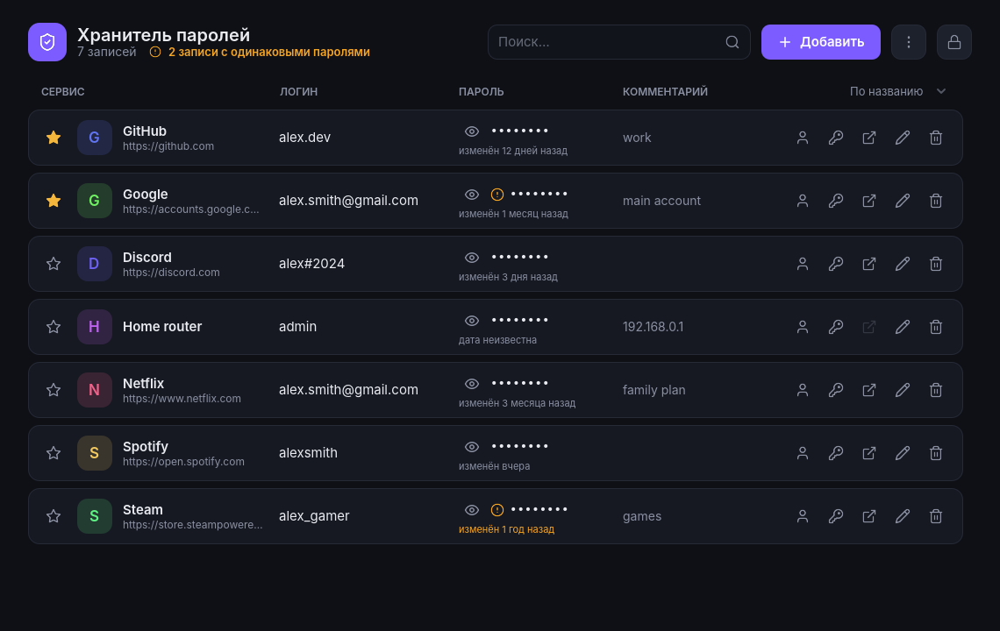
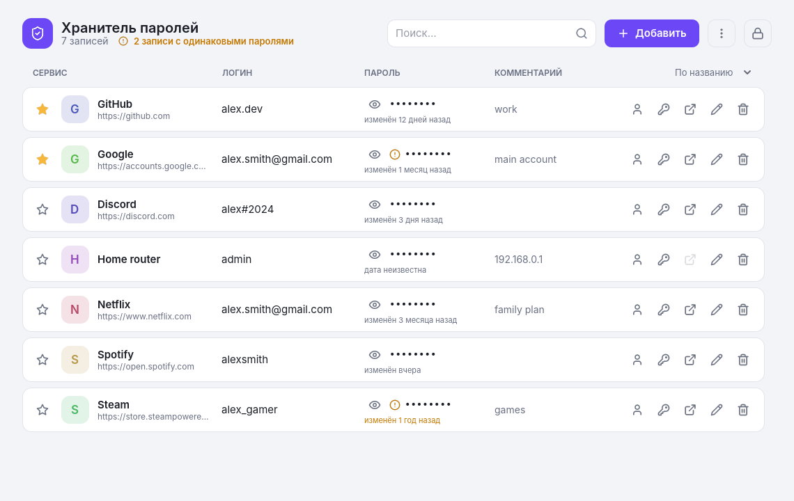
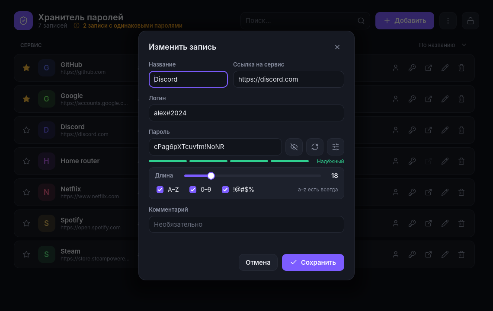

# Хранитель паролей

[English](README.md) · **Русский**

Простой локальный менеджер паролей для Windows, написанный на [Godot 4](https://godotengine.org) и GDScript.
Пароли никуда не отправляются: они хранятся на твоём компьютере в одном зашифрованном файле.

## Возможности

- **Надёжное шифрование**: AES-256, ключ получается из мастер-пароля через PBKDF2-HMAC-SHA256 (300 000 повторов) со случайной солью. Каждый файл подписан HMAC, поэтому неверный пароль или повреждённый файл сразу распознаются.
- **Безопасное сохранение**: данные сначала пишутся во временный файл и проверяются, а предыдущая версия остаётся резервной копией. Если свет пропадёт посреди сохранения, ничего не потеряется.
- **Автоблокировка** через 5 минут бездействия. Показанный пароль прячется через 15 секунд, а скопированный пароль стирается из буфера обмена через 30 секунд.
- **Генератор паролей**: длина от 8 до 64 символов, выбор видов символов, индикатор надёжности.
- **Поиск одинаковых паролей**: видно, какие записи используют один и тот же пароль.
- **Избранное, сортировка, поиск**: по названию, по давности смены пароля, по дате добавления.
- **Возраст пароля**: например, «изменён 3 месяца назад». Пароли старше года подсвечиваются.
- **Резервные копии**: зашифрованная копия сохраняется куда угодно (например, в облачную папку), и из неё можно восстановить записи.
- **Импорт из браузеров**: CSV из Chrome, Edge, Яндекс.Браузера, Firefox, Bitwarden и KeePass.
- **Логотипы сайтов**: по желанию, скачиваются один раз и хранятся зашифрованными.
- **Светлая и тёмная тема**, можно следовать настройке Windows.
- **Русский и английский** интерфейс.
- **Поддержка масштаба Windows** (125%, 150%…). Ctrl + / Ctrl − / Ctrl 0 меняют размер вручную.
- **Защита от двойного запуска**: при повторном запуске на передний план выходит уже открытое окно.

| Светлая тема | Редактирование записи |
|---|---|
|  |  |

## Скачать

Последняя версия `PasswordKeeper.exe` лежит на странице [Releases](../../releases). Устанавливать ничего не нужно, достаточно запустить файл.

> Windows может показать окно «Windows защитила ваш компьютер», потому что у программы нет цифровой подписи. Нажми **Подробнее → Выполнить в любом случае**.

## Где хранятся данные

Все файлы лежат в папке `%APPDATA%\Godot\app_userdata\PasswordKeeper\`:

| Файл | Что это |
|---|---|
| `vault.dat` | Зашифрованные записи |
| `vault.bak` | Предыдущая версия (автоматическая копия) |
| `icons.dat` | Зашифрованный кэш логотипов сайтов |
| `settings.cfg` | Тема, язык, сортировка (ничего секретного) |

**Делай резервные копии** (меню ⋮ → «Сделать резервную копию…»). Забытый мастер-пароль восстановить невозможно.

## Сборка из исходников

1. Установи [Godot 4.7](https://godotengine.org/download) (обычную версию, не .NET).
2. Склонируй этот репозиторий и открой `project.godot` в Godot.
3. Нажми **F5**, чтобы запустить.
4. Чтобы собрать `.exe`: **Project → Export → Windows Desktop → Export Project**. Godot предложит скачать шаблоны экспорта, это нужно сделать один раз.

Вся программа — это два скрипта:

- `main.gd` — сама программа (интерфейс целиком создаётся кодом);
- `lang_en.gd` — английский перевод.

Подробное описание устройства программы лежит в [документе разработки](docs/).

## О безопасности

Это учебный проект, специалисты по безопасности его не проверяли. Шифрование собрано из стандартных, хорошо изученных частей (PBKDF2, AES-256-CBC, HMAC-SHA256). Но для самых важных аккаунтов лучше использовать зрелые программы, например [KeePassXC](https://keepassxc.org) или [Bitwarden](https://bitwarden.com).

**От чего защищает:** если кто-то получит копию файла с паролями, подобрать мастер-пароль будет очень долго.
**От чего защитить не может:** от вируса на компьютере (например, клавиатурного шпиона). От этого не защищает ни один менеджер паролей.

Если включены логотипы сайтов, адреса сайтов (но не логины и не пароли) отправляются сервису значков Google. Логотипы можно выключить в меню ⋮.

## Лицензия

[MIT](LICENSE) © 2026 niprok
